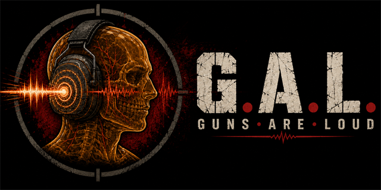

# Guns Are Loud (G.A.L.) — gunfire, hearing loss and active headsets for SPT

[English](README.md) · [Русский](README.ru.md)

**Guns Are Loud** changes how your own gunfire sounds and what it does to your hearing in **SPT (Single Player Tarkov)**. Shots have more low-end weight, and firing a rifle indoors is much harsher on your ears. Keep shooting and the world becomes muffled, with ringing that takes time to fade. A grenade going off nearby can leave you barely hearing anything for several minutes.

The mod builds on EFT's original weapon recordings. Active headsets protect your hearing and change how you hear the world: each model has its own isolation, amplification, sound and response to loud events.

**Version:** 1.2.0

**Supported game:** SPT 4.1.\*

[Download](https://github.com/Anamelash/spt-guns-are-loud/releases/latest) · [All releases](https://github.com/Anamelash/spt-guns-are-loud/releases) · [Discord](https://discord.gg/w2DpURxtrf) · [GitHub Issues](https://github.com/Anamelash/spt-guns-are-loud/issues)

## What you will hear in a raid

- **Your own shots have more weight.** A copy of the original recording pitched an octave lower adds bass and impact. This follows every round of automatic fire at the weapon's actual rate of fire.
- **Loudness follows the cartridge.** How loud your own shot is depends on the muzzle energy of the round and on how far the muzzle is from your ear. A pistol sits below an assault rifle, and a .338 or .50 caliber rifle above both. EFT's recordings and replacement sound packs are mastered to different levels, so G.A.L. measures each recording once and brings it to the level of its cartridge: the stock sounds and a sound pack come out at the same loudness.
- **Your shots are dense.** Most rifle recordings are a short crack with a much quieter room behind it, and at full scale that crack is all a gain can give you. Shot Density rounds the crack off and lets the body and the room of your own shot through at full level, the way most games master their gunshots, so a rifle has the weight of its report and not only its snap. Pistols and shotguns, whose recordings are already dense, are not changed, and the loudness order of the cartridges stays the same. Turn it off to hear the recordings in the shape they were shipped with.
- **Suppressors and brakes sound like the device you fitted.** The game plays one suppressed recording whatever the can, and it is barely quieter than the unsuppressed one. Here the device's own Loudness rating from the game moves your shot: an integral suppressor or a big can takes it well down, a short moderator only a little, a compensator or a brake raises it. The hearing after-effects follow: suppressed pistol-caliber and intermediate fire leaves no hearing loss or ringing, a brake adds to the dose. `Muzzle Device Influence, dB` under Gunshots sets how much a point of the rating is worth; 0 ignores the devices.
- **Cartridges sound different.** Pistol rounds, intermediate cartridges such as 5.45×39, full-power rifle rounds such as 7.62×54R, shotgun shells and heavy 12.7 mm rounds get different amounts of added low end, more for heavier rounds. Every cartridge is placed by the energy of what it fires, so one added by another mod needs nothing special: a .700 Nitro Express sits with the 12.7 mm rounds. Shotgun shells are ranked by the slugs of their gauge. Muzzle devices move the whole shot, added low end included.
- **Indoor shots sound harsher.** Room reflections are stronger, the shot itself is a little louder, and firing inside a building causes more temporary hearing loss than firing outdoors.
- **Hearing loss and ringing build up.** Repeated shots make your surroundings quieter and duller; long bursts take longer to recover from. How much one shot does follows the same cartridge-and-distance scale as its loudness: a pistol fired close to your face is nearly as hard on your ears as an assault rifle, a .50 caliber much harder, while grenade launchers do less than a rifle and flare pistols almost nothing. With a rifle, the ear closer to the muzzle is affected more. Switching shoulders reverses the difference.
- **Heavy rounds get through ear cups.** The more energy a round carries, the more of its low end leaks past a headset's seal. With a headset on, a full-power rifle or a .50 caliber still leaves more hearing loss and ringing behind than an assault rifle, while pistols and 5.45×39 get the headset's full protection.
- **Gunfire stands out from the background.** Gunshot Contrast lowers ambience, footsteps and character speech by a fixed amount. Those useful cues become quieter too, so adjust it to taste. Music, interface sounds and voice chat are unchanged.

### Grenades

- **Explosions are as loud as they are close.** The game fades a blast out with distance the way it fades out footsteps, so a grenade thirty metres away ends up quieter than your own pistol. Explosion Level puts blasts on the same loudness scale as the shots: a hand grenade within about twenty metres is as loud as the heaviest rifle at your shoulder, at thirty metres like a rifle, at forty like a pistol, and it keeps falling off with distance beyond. Walls and occlusion still work as the game intends. Turn it off to hear explosions at the level the game gives them.

A close explosion can leave you with strong muffling and ringing. Distance, indoor or outdoor surroundings, walls between your head and the blast, and your headset all affect how severe it is.

Without protection, a nearby blast can reduce the world to a quiet, muffled rumble for minutes. Low sounds remain audible while higher frequencies fade away, then gradually return as your hearing recovers.

Headsets reduce the after-effect. In the mod, ordinary ear cups roughly halve it: a grenade across the room can still muffle your hearing and leave it ringing, but the effect is less severe than with bare ears. In-ear protection with a high protection rating reduces it further.

## Active headsets

In **Realistic** mode, you hear sound through both the ear cups and the microphones. The cups provide passive protection that varies with frequency. The electronics amplify quiet surroundings, turn down loud events, and recover afterwards.

The profiles cover 29 headset items across 15 real models and families, including supported variants from WTT-ContentBackport and Epic's All In One.

### How the models differ

In the mod, Sordin, ComTac V and VI, and Ops-Core profiles sound relatively clean and quiet. Consumer models such as Walker's Razor and Earmor M32 amplify more, produce more hiss and react more slowly to loud sounds. The first crack of a shot can get through before they turn the sound down. The analog GSSh-01 and ComTac II profiles also have a slower response.

The electronics change the tone too. They pass a limited range of frequencies, bring out the mids around 3 kHz and reduce some bass. A faint hiss is audible in quiet places and gets lost under louder surroundings and gunfire. Loud peaks are softened, and digital profiles add a few milliseconds of delay.

Published figures are used where available: the Sordin microphone range is 100 Hz–10 kHz, GSSh-01 uses 300–7000 Hz, and Walker's Razor has a 0.02 s response time. Other settings are estimates based on the device's construction and its settings in EFT. These profiles approximate the equipment; they are not complete measurements of every headset.

### Item inspection

In Realistic mode, the headset card shows passive protection at low, mid and high frequencies, gain, compressor attack and recovery, microphone range, hiss and sound colouring. Tooltips include the available manufacturer figures. An asterisk marks an estimate or a value borrowed from a related model.

Vanilla mode shows compressor recovery and gain. Unknown headset models keep vanilla processing. If Realistic processing cannot be used, the mod also falls back to Vanilla.

## Sound Engine Backport

G.A.L. works together with [Sound Engine Backport](https://github.com/RedTheFoxx/SPT-SEB) (SEB) 1.0.0, including its live gun engine and live mixer. Install both mods as usual; nothing needs to be set.

- **Your shots are SEB's recordings with G.A.L. on top.** The added low end, cartridge and muzzle device differences, indoor emphasis, hearing loss, ringing and Gunshot Contrast all apply. SEB's recordings are brought to the same loudness as the stock sounds for the same cartridge, and the added layer follows each shot, including during the first seconds after you pick up a weapon. SEB's Gunshots volume slider stays yours: G.A.L. reads it from SEB's settings and keeps your shots, and their added layer, that much louder or quieter.
- **Every round is a whole shot.** SEB's live engine plays each round of automatic fire as a complete recording, so each round gets its own added copy. Automatic Weapon Route and Automatic Report Shape do not apply to those weapons; Automatic Report Overlap does.
- **Realistic headsets work under SEB's mixer.** G.A.L. carries its own version of the SEB 1.0.0 mixer, and Headset Diagnostics shows `DSP active (SEB)`. SEB's Ambience setting keeps working with a headset on. SEB's own per-headset rain level is not used in Realistic: the headset's ear cups decide how loud rain is.
- **Bursts in a headset are a little louder with SEB**, by about 2–3 dB against the stock sounds. SEB plays every round with its own room tail, and those tails pile up below the level where the headset's electronics start turning sound down, so a burst in a room keeps more of its reverberation. That is how SEB's recordings behave, and G.A.L. leaves it as it is.
- **Another SEB version.** If the installed SEB's mixer is not the one G.A.L. knows, Realistic is unavailable and Headset Diagnostics shows `DSP off — Sound Engine Backport mixer` with the reason; headsets then sound as SEB makes them. Turning off SEB's live mixer in its own settings brings G.A.L.'s mixer and Realistic back.

## Installation and updates

You need **SPT 4.1.5 on Windows x64**, with the Unity 2022.3.43f1 player shipped with that version. BepInEx 5 is included with SPT. Other Unity player builds are not automatically supported: the preloader checks for the supported game and audio component before loading it.

1. Close the game.
2. Extract the release archive into your SPT installation folder.
3. Merge the included `BepInEx` folders with the existing ones. Do not replace the entire BepInEx directory.
4. Start the game through the SPT Launcher.

The archive contains three required files:

- `BepInEx/plugins/GunsAreLoud/GunsAreLoud.Client.dll`
- `BepInEx/patchers/GunsAreLoud/GunsAreLoud.Preloader.dll`
- `BepInEx/patchers/GunsAreLoud/GalHeadphoneElectronics.dll`

**Replace all three when updating.** They must come from the same release. Mixing versions leaves headset processing on Vanilla; the reason is recorded in the log. Releases before 1.1.2 shipped the third file as `AudioPluginGalHeadphones.dll`; that file is no longer used and can be deleted.

Your saved settings are preserved. Older settings are migrated on first launch where needed. The release archive needs no compilation, Unity Editor, separate installer or manual game-file edits.

## Settings

Press **F12** to open Configuration Manager. The main controls are grouped into:

- **General:** the master switch, loudness preset, Hearing Loss and Ringing switches, Headset Processing, Headset Fit, Hear-through Character and Headset Caliber Penalty.
- **Gunshots:** impact, contrast, Shot Density, muzzle device influence, indoor emphasis, hearing-loss and ringing intensity and duration, and the difference between your ears.
- **Explosions:** Explosion Level, hearing-loss and ringing strength and duration, close-blast duration, outdoor radius and the indoor radius multiplier.

The presets give you a starting point: **Balanced** is restrained, **Loud** makes gunfire more dominant, and **Punishing** gives it the strongest and longest effects.

**Hearing Loss** and **Ringing** can each be turned off for both gunfire and explosions. Their strength and duration are adjusted separately, so you can keep the heavier shots without either after-effect.

**Headset Processing** selects Vanilla or Realistic. **Headset Fit** changes how much protection the hearing model assumes: Loose represents a poor seal, Normal the baseline, and Tight a good seal. It does not change the headset's sound.

`Headset Caliber Penalty, dB` (6 dB by default, up to 10) is how much protection a .50 BMG round takes away from a worn headset. Lighter rounds take proportionally less, about a third of it for 7.62×51, and pistols and 5.45×39 take none. 0 gives every cartridge the same protection. Like Headset Fit, it changes hearing loss and ringing, not the headset's sound.

### Hear-through Character

`Hear-through Character, %` adjusts the tone, hiss and soft limiting of headset electronics in Realistic mode.

| Value | What you hear |
|---|---|
| 0% | No added colouring or hiss; amplification, microphone range and protection remain |
| 100% | The estimated character of each headset |
| Up to 200% | More pronounced colouring, hiss and limiting |

This setting does not affect Vanilla mode.

The **Advanced** checkbox reveals the controls under **Low-level & debug**. Most players can leave those at their defaults.

### Shot loudness

These controls are under **Low-level & debug**:

| Setting | Default | What it does |
|---|---|---|
| `Direct Level Normalization, dB` | 12 | How strongly the loudness of your own shot follows the cartridge instead of the recording. 0 plays the recordings as shipped; 12 is the full correction. The whole shot moves together, recording, tail, room and added low end, and never peaks above a fixed budget before the output limiter: a loud recording is turned down, a quiet one is lifted only as far as its peak allows. |
| `Direct Level Target` | Energy | Energy follows the round's muzzle energy and the distance from the muzzle to your ear, a little louder indoors. Baseline uses four fixed levels: pistol, intermediate, rifle and heavy. |
| `Copy Headroom, dB` | 3 | How much of a shot's peak budget the recording leaves to the added low end. 0 gives the recording the whole budget and cuts the low end of loud rifles hard; more headroom keeps more low end and makes those shots a little quieter. Only shots that would exceed the budget are affected. |
| `Shot Density, dB` | 6 | How far your own shot is driven into the output limiter when `Shot Density` (Gunshots) is on, from 1 to 9. More is denser: the crack is rounded off further and the body and room come up further. Dense recordings, pistols and shotguns among them, are not affected; sparse ones, most rifles, are. |
| `Cartridge Contrast, dB` | 3 | How far apart cartridges sit in the added low end, as the level of an intermediate rifle round above 9×19. 0 removes the difference; 9 is the maximum. It does not change the rest of the gunshot. |

G.A.L. measures a weapon's recordings when you equip it and keeps the results in `BepInEx/plugins/GunsAreLoud/GunsAreLoud.LevelCache.json`, next to the diagnostics log. A weapon you have fired in an earlier session therefore has its full low end and its corrected loudness from its first shot. A weapon you have never used, or a sound pack you have changed, is measured the first time you pick it up. The file is safe to delete; the recordings are then measured again. `Reset Level Cache` under Low-level & debug does the same from F12: it empties the file and measures the weapon in hand again at once.

## Status and troubleshooting

**F12 → General → Headset Diagnostics** shows the status of Realistic headset processing:

| Status | Meaning |
|---|---|
| `DSP loading` | Waiting for the raid audio to load |
| `DSP ready` | The audio component is available, but active Realistic processing is not currently confirmed; this can happen in Vanilla mode or without a headset |
| `DSP active` | Realistic processing is connected and running |
| `DSP active (SEB)` | The same, inside Sound Engine Backport's mixer |
| `DSP off — … mixer` | Another mod's mixer has taken over the game audio; Realistic is unavailable, and the reason follows the colon |
| `DSP error` | A problem was detected; check `BepInEx/LogOutput.log` |

If something sounds wrong, report it on [GitHub](https://github.com/Anamelash/spt-guns-are-loud/issues) with `BepInEx/LogOutput.log` from that session. Include your SPT version, headset and the settings you were using.

For more detail, **Performance Summary Log** and **Log Every Local Shot** under Low-level & debug write to `BepInEx/plugins/GunsAreLoud/GunsAreLoud.Diagnostics.log`. Both are off by default. Log Every Local Shot turns itself off at the next game start; enable it when reproducing a problem.

## Uninstallation

Close the game and remove:

- `BepInEx/plugins/GunsAreLoud`
- `BepInEx/patchers/GunsAreLoud`

The first folder also holds the measurement file and the diagnostics log. You can also remove `BepInEx/config/com.anamelash.gunsareloud.cfg` to discard the saved settings.

The release archive does not modify `globalgamemanagers` or put files in the game's native `Plugins` directory. If you used a development build that required manual registration there, first restore its original game-metadata backup, then remove the native DLL it installed. Do not leave a preload entry pointing to a DLL you have removed.

## Scope and limitations

G.A.L. changes the local player's sound and hearing. Ballistics, recoil, damage, health, AI hearing, other players' gunshot sources and EFT's original sound files are unchanged. The headset profiles are client-side; no server-side item changes are needed.

The model uses relative digital audio levels. They are not calibrated sound-pressure measurements and cannot tell you how much real hearing protection equipment provides or how safe real gunfire or blasts are.

## Documentation and feedback

- [CHANGELOG.md](CHANGELOG.md) — differences from vanilla and changes between releases.
- [MODEL.md](MODEL.md) — the audio and hearing model, formulas and limitations.
- [Headset reference](docs/reference/headphones/README.md) — sources and calibration choices for the headset profiles.

Questions and discussion are welcome on [Discord](https://discord.gg/w2DpURxtrf). Use [GitHub Issues](https://github.com/Anamelash/spt-guns-are-loud/issues) for bug reports and suggestions. Downloads are under [Releases](https://github.com/Anamelash/spt-guns-are-loud/releases).
