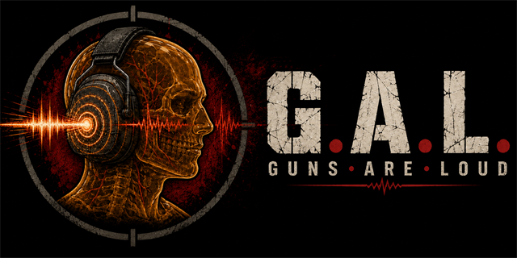

# Guns Are Loud (G.A.L.) — звук выстрелов, оглушение и активные наушники для SPT

[English](README.md) · [Русский](README.ru.md)

**Guns Are Loud** меняет звук ваших выстрелов и их влияние на слух в **SPT (Single Player Tarkov)**. В звуке становится больше баса, а стрельба из винтовки в помещении сильнее бьёт по ушам. После долгой очереди окружающие звуки приглушаются, появляется звон, который проходит не сразу. Граната, взорвавшаяся рядом, может почти оглушить на несколько минут.

Мод использует оригинальные записи оружия из EFT. Активные наушники защищают слух и меняют то, как вы слышите окружающий мир: у каждой модели своя звукоизоляция, усиление, тембр и реакция на громкие звуки.

**Версия:** 1.2.0

**Поддерживаемая игра:** SPT 4.1.5 на Windows x64

[Скачать](https://github.com/Anamelash/spt-guns-are-loud/releases/latest) · [Все релизы](https://github.com/Anamelash/spt-guns-are-loud/releases) · [Discord](https://discord.gg/w2DpURxtrf) · [GitHub Issues](https://github.com/Anamelash/spt-guns-are-loud/issues)

## Что меняется в рейде

- **Ваши выстрелы звучат мощнее.** К оригинальной записи добавляется копия на октаву ниже, которая даёт больше баса. При автоматической стрельбе эффект приходится на каждый выстрел и следует реальному темпу оружия.
- **Громкость зависит от патрона.** Насколько громко звучит ваш выстрел, определяют дульная энергия патрона и расстояние от дульного среза до уха. Пистолет звучит тише автомата, а винтовка под .338 или .50 — громче обоих. Записи EFT и сторонние звуковые паки сведены на разную громкость, поэтому G.A.L. один раз измеряет каждую запись и приводит её к уровню её патрона: стоковые звуки и звуковой пак звучат одинаково громко.
- **Ваши выстрелы плотные.** Большинство винтовочных записей — короткий щелчок и куда более тихая комната за ним, и у полной шкалы этот щелчок — всё, что может дать усиление. Shot Density скругляет щелчок и пропускает тело и комнату вашего выстрела на полном уровне, как сводят выстрелы в большинстве игр: у винтовки появляется вес её выстрела, а не только хлопок. Пистолеты и дробовики, чьи записи и так плотные, не меняются, порядок громкости патронов сохраняется. Выключите параметр, чтобы слышать записи в том виде, в каком они поставляются.
- **Глушители и ДТК звучат как то устройство, что стоит на оружии.** Игра играет одну и ту же глушёную запись при любом глушителе, и она почти не тише обычной. Здесь выстрел двигает собственный рейтинг Loudness устройства из игры: интегральный глушитель или большая банка заметно гасят выстрел, короткий модератор чуть-чуть, компенсатор или ДТК делают его громче. Оглушение и звон следуют за этим: глушёная стрельба пистолетными и промежуточными патронами больше не оглушает. `Muzzle Device Influence, dB` в Gunshots задаёт цену одного пункта рейтинга; 0 отключает учёт устройств.
- **Калибры различаются на слух.** Пистолетные патроны, промежуточные вроде 5,45×39, винтовочные вроде 7,62×54R, патроны для дробовиков и крупнокалиберные 12,7 мм получают разное количество добавленного баса — тем больше, чем тяжелее патрон. Каждый патрон оценивается по энергии того, чем он стреляет, поэтому патрону из другого мода не нужна отдельная поддержка: .700 Nitro Express встаёт рядом с 12,7 мм. Патроны для дробовиков оцениваются по пулям своего калибра. Глушитель убирает большую часть добавленного эффекта, а выстрел с глушителем звучит на 6 дБ тише того же выстрела без него.
- **В помещении выстрелы резче.** Звук сильнее отражается от стен, сам выстрел немного громче, а слух приглушается сильнее, чем при стрельбе на улице.
- **Оглушение и звон накапливаются.** Чем дольше стреляете, тем тише и глуше становятся окружающие звуки и тем больше времени нужно на восстановление. Сколько вредит один выстрел, определяет та же шкала патрона и расстояния, что и его громкость: пистолет у самого лица бьёт по ушам почти как автомат, .50 — намного сильнее, гранатомёт — слабее винтовки, а сигнальный пистолет почти не действует. При стрельбе из винтовки сильнее страдает ухо, которое ближе к дульному срезу. Смена плеча меняет стороны эффекта.
- **Тяжёлые патроны пробивают чашки наушников.** Чем больше энергия патрона, тем больше его низких частот проходит сквозь уплотнение наушников. Даже в наушниках винтовка под полноценный винтовочный патрон или .50 оставляет больше оглушения и звона, чем автомат, а пистолеты и 5,45×39 получают полную защиту наушников.
- **Стрельба выделяется на фоне остальных звуков.** Gunshot Contrast снижает громкость окружения, шагов и речи персонажей. Полезные звуки тоже становятся тише, поэтому настройте этот параметр под себя. Музыка, интерфейс и голосовой чат остаются без изменений.

### Гранаты

- **Взрывы громки настолько, насколько близки.** Игра приглушает взрыв с расстоянием так же, как шаги, и граната в тридцати метрах выходит тише вашего пистолета. Explosion Level ставит взрывы на ту же шкалу громкости, что и выстрелы: ручная граната в пределах примерно двадцати метров звучит как самая тяжёлая винтовка у плеча, в тридцати — как винтовка, в сорока — как пистолет, а дальше продолжает затихать с расстоянием. Стены и перекрытия работают как задумано в игре. Выключите параметр, чтобы слышать взрывы на уровне, который даёт им игра.

Близкий взрыв может сильно приглушить слух и оставить звон в ушах. Сила эффекта зависит от расстояния, помещения или открытого пространства, стен между головой и взрывом, а также от надетых наушников.

Без защиты после близкой гранаты на несколько минут может остаться только тихий, глухой гул. Низкие звуки ещё слышны, а высокие частоты пропадают и постепенно возвращаются по мере восстановления.

Наушники смягчают последствия. В модели обычные чашки уменьшают эффект примерно вдвое: граната в другом конце комнаты всё ещё приглушает слух и вызывает звон, но не так сильно, как без защиты. Внутриканальные наушники с высоким уровнем защиты снижают эффект ещё больше.

## Активные наушники

В режиме **Realistic** звук доходит до ушей через сами чашки и через микрофоны. Чашки пассивно ослабляют внешние звуки, причём разные частоты — по-разному. Электроника усиливает тихое окружение, приглушает громкие звуки и затем возвращает усиление.

Профили охватывают 29 игровых предметов и 15 реальных моделей и семейств, включая поддерживаемые варианты из WTT-ContentBackport и Epic's All In One.

### Чем отличаются модели

В моде Sordin, ComTac V и VI, а также Ops-Core звучат относительно чисто и тихо. Бюджетные модели вроде Walker's Razor и Earmor M32 сильнее усиливают звук, больше шипят и медленнее реагируют на громкие звуки. Начало выстрела может успеть прозвучать до того, как электроника его приглушит. У аналоговых профилей ГСШ-01 и ComTac II реакция тоже медленнее.

Электроника меняет и тембр. Она пропускает ограниченный диапазон частот, подчёркивает средние частоты около 3 кГц и немного убирает бас. В тихом месте слышно лёгкое шипение, которое теряется на фоне окружения и стрельбы. Пики громкости сглаживаются, а цифровые профили добавляют задержку в несколько миллисекунд.

Где есть опубликованные цифры, используются они: диапазон микрофона Sordin — 100 Гц–10 кГц, ГСШ-01 — 300–7000 Гц, время срабатывания Walker's Razor — 0,02 с. Остальные параметры оценены по конструкции устройства и его настройкам в EFT. Это приближение, а не полный набор измерений каждой гарнитуры.

### Осмотр предмета

В режиме Realistic карточка наушников показывает защиту на низких, средних и высоких частотах, усиление, скорость срабатывания и восстановления компрессора, диапазон микрофона, шум и изменение тембра. В подсказках приведены доступные данные производителя. Звёздочкой отмечены оценки и значения, взятые у близкой модели.

В режиме Vanilla показаны восстановление компрессора и усиление. Для неизвестных моделей сохраняется ванильная обработка. Если режим Realistic недоступен, мод также использует Vanilla.

## Sound Engine Backport

G.A.L. работает вместе с [Sound Engine Backport](https://github.com/RedTheFoxx/SPT-SEB) (SEB) 1.0.0, включая его живой движок выстрелов и живой микшер. Оба мода ставятся как обычно, настраивать ничего не нужно.

- **Ваши выстрелы — это записи SEB с обработкой G.A.L. поверх.** Работают добавленный низ, разница калибров и глушителей, эффект помещения, оглушение, звон и Gunshot Contrast. Записи SEB приводятся к той же громкости, что и стоковые звуки того же патрона, а добавленный слой следует за каждым выстрелом, в том числе в первые секунды после того, как вы взяли оружие. Ползунок громкости выстрелов SEB остаётся вашим: G.A.L. читает его из настроек SEB и делает ваши выстрелы вместе с добавленным слоем настолько же громче или тише.
- **Каждый патрон — целый выстрел.** Живой движок SEB играет каждый патрон очереди полной записью, поэтому каждый патрон получает свою добавленную копию. Automatic Weapon Route и Automatic Report Shape к такому оружию не применяются, Automatic Report Overlap — применяется.
- **Наушники Realistic работают в микшере SEB.** В G.A.L. встроена своя версия микшера SEB 1.0.0, и Headset Diagnostics показывает `DSP active (SEB)`. Настройка Ambience из SEB продолжает работать и в наушниках. Собственная громкость дождя SEB для каждой модели наушников в Realistic не используется: насколько громок дождь, решают чашки наушников.
- **Очереди в наушниках с SEB немного громче** — примерно на 2–3 дБ по сравнению со стоковыми звуками. SEB играет каждый патрон со своим хвостом помещения, и эти хвосты складываются ниже уровня, с которого электроника наушников начинает приглушать звук, поэтому очередь в помещении сохраняет больше реверберации. Так звучат записи SEB, и G.A.L. это не исправляет.
- **Другая версия SEB.** Если микшер установленного SEB незнаком G.A.L., режим Realistic недоступен: Headset Diagnostics показывает `DSP off — Sound Engine Backport mixer` с причиной, а наушники звучат так, как их делает SEB. Если выключить живой микшер в настройках самого SEB, вернутся микшер G.A.L. и режим Realistic.

## Установка и обновление

Нужен **SPT 4.1.5 на Windows x64** с той сборкой Unity 2022.3.43f1, которая входит в эту версию игры. BepInEx 5 уже включён в SPT. Поддержка других сборок Unity не гарантируется: прелоадер проверяет совместимость игры и аудиокомпонента перед его загрузкой.

1. Закройте игру.
2. Распакуйте архив релиза в папку установки SPT.
3. Объедините папки `BepInEx` из архива с существующими. Не заменяйте целиком каталог BepInEx.
4. Запустите игру через лаунчер SPT.

В архиве три обязательных файла:

- `BepInEx/plugins/GunsAreLoud/GunsAreLoud.Client.dll`
- `BepInEx/patchers/GunsAreLoud/GunsAreLoud.Preloader.dll`
- `BepInEx/patchers/GunsAreLoud/GalHeadphoneElectronics.dll`

**При обновлении заменяйте все три.** Файлы должны быть из одного релиза. Если смешать версии, наушники останутся в режиме Vanilla, а причина будет записана в лог. До версии 1.1.2 третий файл назывался `AudioPluginGalHeadphones.dll`; он больше не используется, его можно удалить.

Сохранённые настройки остаются на месте. При необходимости параметры старых версий переносятся при первом запуске. Для установки готового архива не нужны компиляция, Unity Editor, отдельный установщик или ручная правка файлов игры.

## Настройки

Нажмите **F12**, чтобы открыть Configuration Manager. Основные параметры разделены на группы:

- **General:** включение мода, пресет, переключатели Hearing Loss и Ringing, режим Headset Processing, посадка Headset Fit, характер электроники Hear-through Character и штраф защиты для тяжёлых патронов Headset Caliber Penalty.
- **Gunshots:** усиление выстрелов, контраст, плотность выстрела Shot Density, влияние дульных устройств, эффект помещения, сила и длительность оглушения и звона, разница между ушами.
- **Explosions:** уровень взрывов Explosion Level, сила и длительность оглушения и звона, длительность эффекта близкого взрыва, радиус на улице и множитель радиуса в помещении.

Пресеты дают исходные настройки: **Balanced** — умеренные, **Loud** сильнее выделяет стрельбу, **Punishing** делает эффекты самыми сильными и продолжительными.

**Hearing Loss** и **Ringing** можно отключить по отдельности сразу для выстрелов и взрывов. Сила и длительность каждого эффекта настраиваются независимо: можно оставить изменённый звук стрельбы без оглушения и звона.

**Headset Processing** выбирает Vanilla или Realistic. **Headset Fit** задаёт, какую защиту предполагает модель слуха: Loose — плохое прилегание, Normal — обычное, Tight — плотное. На сам звук наушников этот параметр не влияет.

`Headset Caliber Penalty, dB` (по умолчанию 6 дБ, максимум 10) — сколько защиты надетых наушников отнимает патрон .50 BMG. Более лёгкие патроны отнимают пропорционально меньше, для 7,62×51 примерно треть, а пистолетные и 5,45×39 не отнимают ничего. При 0 защита одинакова для всех патронов. Как и Headset Fit, параметр меняет оглушение и звон, а не звук наушников.

### Hear-through Character

`Hear-through Character, %` регулирует изменение тембра, шипение и мягкое ограничение громкости электроникой наушников в режиме Realistic.

| Значение | Что слышно |
|---|---|
| 0% | Без добавленного изменения тембра и шипения; усиление, диапазон микрофона и защита сохраняются |
| 100% | Предполагаемый характер каждой модели наушников |
| До 200% | Более заметное изменение тембра, шипение и ограничение громкости |

На режим Vanilla этот параметр не влияет.

Флажок **Advanced** открывает параметры в **Low-level & debug**. Для обычной игры их можно оставить по умолчанию.

### Громкость выстрела

Эти параметры находятся в **Low-level & debug**:

| Параметр | По умолчанию | Что делает |
|---|---|---|
| `Direct Level Normalization, dB` | 12 | Насколько громкость вашего выстрела следует за патроном, а не за записью. 0 — записи звучат как есть, 12 — полная коррекция. Выстрел движется целиком: запись, её хвост, комната и добавленный бас, и никогда не превышает заданный пиковый бюджет перед выходным ограничителем: громкая запись приглушается, тихая усиливается ровно настолько, насколько позволяет её пик. |
| `Direct Level Target` | Energy | Energy следует за дульной энергией патрона и расстоянием от дульного среза до уха, в помещении чуть громче. Baseline использует четыре фиксированных уровня: пистолетный, промежуточный, винтовочный и крупнокалиберный. |
| `Copy Headroom, dB` | 3 | Какую часть пикового бюджета выстрела запись оставляет добавленному басу. 0 отдаёт записи весь бюджет и сильно срезает бас громких винтовок; больший запас сохраняет больше баса и делает такие выстрелы чуть тише. Влияет только на выстрелы, которые иначе превысили бы бюджет. |
| `Shot Density, dB` | 6 | Насколько ваш выстрел загоняется в выходной ограничитель при включённом `Shot Density` (Gunshots), от 1 до 9. Больше — плотнее: щелчок скругляется сильнее, тело и комната поднимаются выше. Плотные записи, в том числе пистолеты и дробовики, не затрагиваются; редкие, то есть большинство винтовок, затрагиваются. |
| `Cartridge Contrast, dB` | 3 | Насколько различаются патроны в добавленном басе: уровень промежуточного винтовочного патрона над 9×19. 0 убирает разницу, 9 — максимум. Остальную часть выстрела не меняет. |

G.A.L. измеряет записи оружия, когда вы берёте его в руки, и сохраняет результаты в `BepInEx/plugins/GunsAreLoud/GunsAreLoud.LevelCache.json`, рядом с диагностическим логом. Поэтому оружие, из которого вы стреляли в одной из прошлых сессий, звучит с полным басом и исправленной громкостью с первого выстрела. Оружие, которое вы ещё не брали, или сменённый звуковой пак измеряются, когда вы впервые берёте оружие в руки. Файл можно спокойно удалить: записи просто измерятся заново. То же делает кнопка `Reset Level Cache` в Low-level & debug: она очищает файл и сразу заново измеряет оружие в руках.

## Если возникли проблемы со звуком

В **F12 → General → Headset Diagnostics** показан статус обработки наушников в режиме Realistic:

| Статус | Значение |
|---|---|
| `DSP loading` | Ожидание загрузки звука рейда |
| `DSP ready` | Аудиокомпонент доступен, но работа Realistic сейчас не подтверждена; такое бывает в Vanilla или без наушников |
| `DSP active` | Обработка Realistic подключена и работает |
| `DSP active (SEB)` | То же самое внутри микшера Sound Engine Backport |
| `DSP off — … mixer` | Звук игры перехватил микшер другого мода; режим Realistic недоступен, причина указана после двоеточия |
| `DSP error` | Обнаружена проблема; подробности в `BepInEx/LogOutput.log` |

Если звук работает неправильно, создайте сообщение на [GitHub](https://github.com/Anamelash/spt-guns-are-loud/issues) и приложите `BepInEx/LogOutput.log` из этой сессии. Укажите версию SPT, модель наушников и настройки, с которыми играли.

Для подробного отчёта есть **Performance Summary Log** и **Log Every Local Shot** в Low-level & debug. Они записывают данные в `BepInEx/plugins/GunsAreLoud/GunsAreLoud.Diagnostics.log`. Оба выключены по умолчанию. Log Every Local Shot снова отключается при следующем запуске игры; включайте его, когда воспроизводите проблему.

## Удаление

Закройте игру и удалите:

- `BepInEx/plugins/GunsAreLoud`
- `BepInEx/patchers/GunsAreLoud`

В первой папке также лежат файл замеров и диагностический лог. Чтобы удалить и сохранённые настройки, уберите `BepInEx/config/com.anamelash.gunsareloud.cfg`.

Готовый архив не меняет `globalgamemanagers` и не добавляет файлы в нативную папку `Plugins` игры. Если вы ставили сборку для разработки с ручной регистрацией, сначала верните исходную резервную копию метаданных игры, затем удалите установленную той сборкой нативную DLL. Запись предзагрузки не должна ссылаться на уже удалённый файл.

## Ограничения

G.A.L. меняет звук и восприятие локального игрока. Баллистика, отдача, урон, здоровье, слух ИИ, источники выстрелов других игроков и оригинальные звуковые файлы EFT остаются без изменений. Профили наушников работают на клиенте; менять предметы на сервере не нужно.

Уровни звука в модели — относительные цифровые значения. По ним нельзя оценивать реальное звуковое давление, защиту настоящих наушников или безопасность стрельбы и взрывов для слуха.

## Документация и обратная связь

- [CHANGELOG.md](CHANGELOG.md) — отличия от ванили и изменения между релизами, на английском.
- [MODEL.md](MODEL.md) — модель звука и слуха, формулы и ограничения, на английском.
- [Справочник наушников](docs/reference/headphones/README.md) — источники данных и выбор параметров для профилей.

Вопросы и обсуждения — в [Discord](https://discord.gg/w2DpURxtrf). Ошибки и предложения можно оставлять в [GitHub Issues](https://github.com/Anamelash/spt-guns-are-loud/issues). Архивы мода доступны в [Releases](https://github.com/Anamelash/spt-guns-are-loud/releases).
